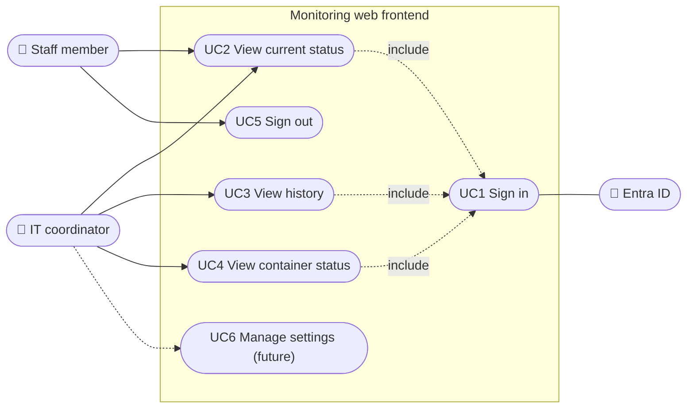

# Use Cases – Monitoring Web Frontend (CS3 Task 1)

## Actors

| Actor | Who | Needs |
|---|---|---|
| Staff member | Library employee, no CLI knowledge | Check whether systems are OK |
| IT coordinator | Manages the IT environment | Same as staff + history and containers to troubleshoot; later: settings |
| Entra ID (system) | IronWolfBV tenant | Authenticates every user (REQ-002) |

Today both human actors get the same rights (RBAC inside the app is out of scope). The design leaves room for it: Entra ID **app roles** (`Viewer`, `Admin`) can later be put in the sign-in token and checked per page, without changing the sign-in flow.

## Diagram

## Use cases

| ID | Name | Actor | Main flow | Req |
|---|---|---|---|---|
| UC1 | Sign in | All | User opens the app → redirected to Entra ID → signs in (+ MFA, Conditional Access) → back to the app with a session. No session = no page. | REQ-002 |
| UC2 | View current status | Staff, IT coordinator | Overview page: latest CPU, memory and disk per host, with the time of the last measurement. | REQ-001 |
| UC3 | View history | IT coordinator | Choose host, metric and time range → table of measurements + averages (same as the CLI `report --average`). | REQ-001 |
| UC4 | View container status | IT coordinator | Containers page: per container name, state (running/stopped), CPU %, memory. | REQ-006 |
| UC5 | Sign out | All | Ends the app session and the Entra session. | REQ-002 |
| UC6 | Manage settings | IT coordinator | *Future, out of scope:* e.g. thresholds; only for app role `Admin`. | – |

## Pages that follow from this

1. `/` – overview (UC2)
2. `/history` – filter + table + averages (UC3)
3. `/containers` – container status (UC4)
4. `/login`, `/logout` – handled by the Entra sign-in library (UC1, UC5)
